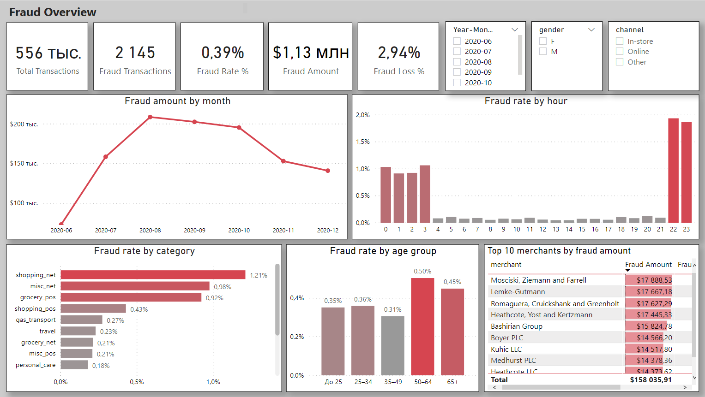
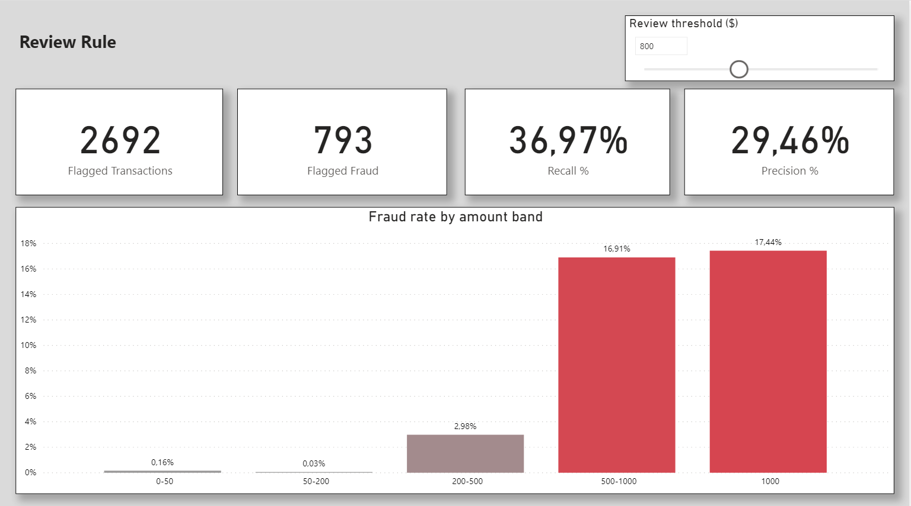

# Fraud Analytics Dashboard (Power BI)

Дашборд для анализа мошеннических транзакций по банковским картам: модель «звезда», меры DAX, параметр для настройки правила проверки с оценкой Recall и Precision, RLS по регионам.

## 📥 Как открыть дашборд

1. Установите бесплатный [Power BI Desktop](https://www.microsoft.com/power-bi/desktop) (Windows).
2. Скачайте архив: **[Fraud_Dashboard_public.zip](https://github.com/akromrahimov/fraud-analytics-powerbi/releases/download/v1.0/Fraud_Dashboard_public.zip)**
3. Распакуйте и откройте `.pbix`. Данные уже внутри файла: все срезы, фильтры и ползунок работают.
4. Кнопку «Обновить» нажимать не нужно: источник данных указан на моём компьютере.

## Скриншоты

**Fraud Overview** — общая картина по фроду

**Review Rule** — правило проверки по сумме

## Данные

- [Credit Card Transactions Fraud Detection](https://www.kaggle.com/datasets/kartik2112/fraud-detection), файл `fraudTest.csv`
- 556 тыс. транзакций за июнь–декабрь 2020 года, синтетические данные

## Что сделано

- **Power Query:** очистка, исправление типов с учётом локали, удаление лишних столбцов; добавлены дата, час и диапазон суммы транзакции.
- **Модель «звезда»:** таблица фактов `Fact_Transactions` и измерения `Dim_Customer`, `Dim_Category` (через группировку) и `Dim_Date` (на DAX).
- **DAX:** возраст и возрастная группа клиента; меры Fraud Rate, Fraud Amount, Fraud Loss, рост к прошлому месяцу (MoM), Recall и Precision.
- **Параметр:** порог суммы для правила проверки операций.
- **RLS:** статические роли по штату (в оригинальной версии файла).
- **Взаимодействия:** срез по месяцу намеренно не влияет на график тренда, чтобы динамика оставалась видна.

## Ключевые выводы

- Мошеннических операций **0,39%** (2 145), но на них приходится **2,94%** оборота ($1,13 млн). Средний чек мошенника около **$527** против **$67** у обычного клиента.
- **Ночь (22:00–03:00)** — главное окно риска: доля фрода примерно в 10 раз выше, чем днём.
- Самые рискованные категории — онлайн-покупки: `shopping_net` (1,21%), `misc_net` (0,98%).
- В операциях от **$500** мошенническая примерно каждая шестая (~17%). Мелкие покупки до $50 похожи на проверку украденной карты.
- Клиенты **50+** страдают от фрода чаще остальных.
- Топ-10 мерчантов дают около **$158 тыс.**, ~14% всех потерь.
- Пик потерь — август (~$210 тыс.), к декабрю снижение до ~$140 тыс.

## Правило проверки по сумме

При пороге **$600** на проверку уходит 4 166 операций (меньше 1% всех). Правило ловит 1 005 из 2 145 мошеннических операций (**Recall 47%**), и каждая четвёртая проверка — настоящий фрод (**Precision 24%**). Ниже порог — больше пойманного фрода, но больше ложных тревог. Выше порог — меньше проверок, но больше пропущенного фрода.

## Рекомендации

- Комбинированное правило: крупная сумма + ночное время + онлайн-покупка.
- Дополнительное подтверждение (SMS, push) для ночных онлайн-операций.
- Отдельное правило для мелких «тестовых» операций.
- Усиленный мониторинг топ-мерчантов.

## Инструменты

Power BI Desktop · Power Query · DAX
